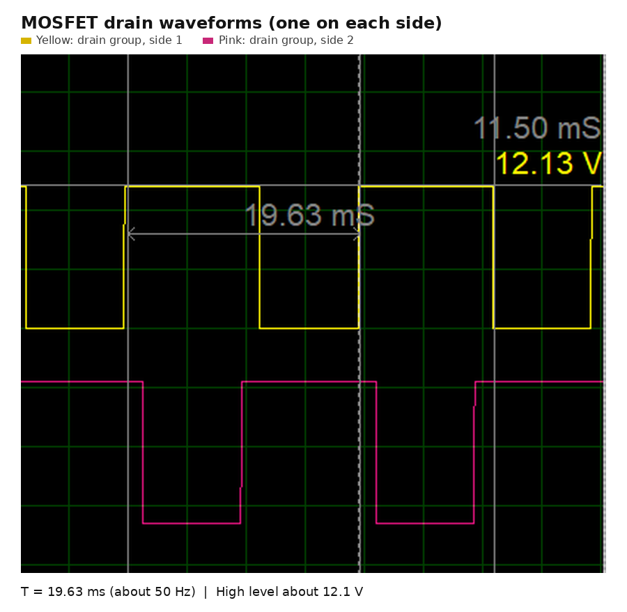
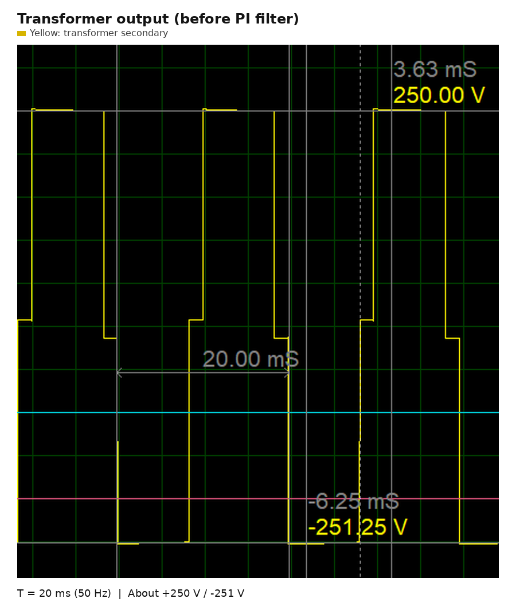

# H.E.R.O Inverter

Closed-loop 12V DC to AC inverter with feedback regulation and protection circuits, designed and simulated in Proteus.

This inverter is the power-conversion stage of **H.E.R.O (Hybrid Energy Resource Optimizer)**, my ongoing off-grid power system project. I designed it in my 2nd semester after teaching myself power electronics.

> **Status:** Inverter stage completed and verified in simulation. Hardware not built.


## Specifications

| Parameter | Value |
|---|---|
| Input | 12V DC battery |
| Output | About 220-230 V AC (RMS) with feedback connected |
| Output frequency | 50 Hz |
| PWM controller | UC3525A |
| Gate drivers | TC4420 |
| Switches | 8x IRF3205 MOSFETs (4 per side) |
| Topology | Push-pull with step-up transformer |
| Simulation tool | Proteus 8 Professional |

## How it works

1. **PWM controller and gate drivers:** The UC3525A generates two complementary PWM signals. Two TC4420 drivers boost them to drive the MOSFET gates quickly. RV2 sets the frequency, and the soft-start capacitor limits turn-on stress.
2. **MOSFET switching stage:** Four IRF3205 MOSFETs on each side of the transformer's center-tapped primary switch alternately, turning the 12V DC into an alternating signal.
3. **Transformer and PI filter:** TR1 steps the voltage up. RC snubbers (R30/C3 and R31/C4) reduce switching spikes. An L-C PI filter (L3, C8, C9) smooths the output.
4. **Under/over-voltage protection:** LM358 comparators (U3:A, U3:B) monitor the voltage against thresholds set by RV1 and RV3, shut down the PWM when it is out of range, and light indicator LEDs (blue for under-voltage, red for over-voltage).
5. **Overcurrent / short-circuit protection:** A 0.01 ohm shunt (R32) senses current. When the sense voltage is high enough, a transistor stage (Q13, Q14) shuts down the PWM and lights an orange indicator LED.
6. **Voltage feedback:** TR2 and a bridge rectifier sample the output and feed a DC level back to the UC3525A, which adjusts the duty cycle to keep the output steady when the load or battery voltage changes. RV4 sets the feedback level. The feedback has a lag of about 1 second (R1 x C1), so the output takes a few seconds to settle.

## Simulation results

Waveforms at each stage (oscilloscope screenshots):

| Stage | Screenshot |
|---|---|
| Gate drive (PWM at MOSFET gates) |  |
| MOSFET drain |  |
| Transformer output (before the filter) |  |
| Final output (after PI filter) |  |

Because the feedback needs a few seconds to settle, a waveform captured early in the run can show a higher peak than the settled output. The settled output is about 220-230 V RMS.

Normal vs fault behavior for the protection and feedback circuits is shown in the documentation PDFs below.

## How to measure the waveforms

Some stages must be isolated so that the next stage does not load the signal you are measuring. Stop the simulation before changing any connection, and reconnect everything afterwards.

| Waveform | Probe at | Disconnect first |
|---|---|---|
| PWM from the controller | UC3525A pins 11 and 14 | Nothing |
| Gate drive | MOSFET gates (for example Q1G and Q5G), after the TC4420 drivers | The transformer (TR1) |
| MOSFET drain | A drain on each side (for example Q1D and Q5D) | The transformer (TR1) |
| Transformer output (before the filter) | TR1 secondary, before L3 | The PI filter |
| Final output (after the filter) | Output Test Point (FB+) | Nothing. Filter and transformer connected |

Settings and tips:
- Use the same time/div for all four so the timing lines up (about 5 ms/div shows 2-3 cycles at 50 Hz).
- Use at most 3 cursors: two for the period (about 20 ms) and one for the peak voltage.
- Pause the simulation before taking each screenshot.
- Reconnect the transformer and the filter before testing the feedback and the protections.

## Testing the feedback and protections

- **Voltage feedback:** put an AC voltmeter (RMS) across FB+ and FB- and a DC voltmeter across C1. Let the simulation run for several seconds so the feedback settles, then compare the output with the feedback connected and with it disconnected (delete or rename one WP1 terminal).
- **Under/over-voltage protection:** **disconnect the feedback first. This is required to check whether the protection is working.** Then test at 12 V (normal), 14 V (over-voltage, red LED) and 10 V (under-voltage, blue LED).
- **Overcurrent protection:** disconnect the feedback, then either lower the load resistance until the orange LED lights, or force the fault by raising the sense voltage across R32.

Details and screenshots are in the documentation PDFs.

## Documentation

Each section has a PDF with the schematic, explanation and simulation screenshots:

1. [PWM Controller and Gate Drivers](Documentation/01_PWM_Controller_and_Gate_Drivers.pdf)
2. [MOSFET Switching Stage](Documentation/02_MOSFET_Switching_Stage.pdf)
3. [Transformer and PI Filter](Documentation/03_Transformer_and_PI_Filter.pdf)
4. [Under/Over-Voltage Protection](Documentation/04_Under_Over_Voltage_Protection.pdf)
5. [Overcurrent Protection](Documentation/05_Overcurrent_Protection.pdf)
6. [Voltage Feedback](Documentation/06_Voltage_Feedback.pdf)

Also: [Component List](Documentation/Component_List.pdf) | [Full circuit (PDF)](Inverter_Circuit/Final_Inverter_Circuit.pdf)

## Repository structure

```
Circuit/          Schematic images and block diagram
Simulation/       Proteus project files
Documentation/    Per-section explanations and test screenshots
Results/          Waveforms from each stage
```

## How to run the simulation

1. Install Proteus 8 Professional.
2. Open the project file in `Simulation/Proteus_Project/`.
3. Press Play. View the waveforms on the oscilloscope.
4. Keep the AC voltmeter connected across FB+ and FB-, since the simulation runs correctly with it in place.

## Future improvements

- Input fuse and reverse polarity protection
- Hardware prototype (scaled-down version)
- Integration with the rest of the H.E.R.O system (solar, wind and battery management)

## Author

Rihan, BSc EMCS, National College, Basavanagudi
