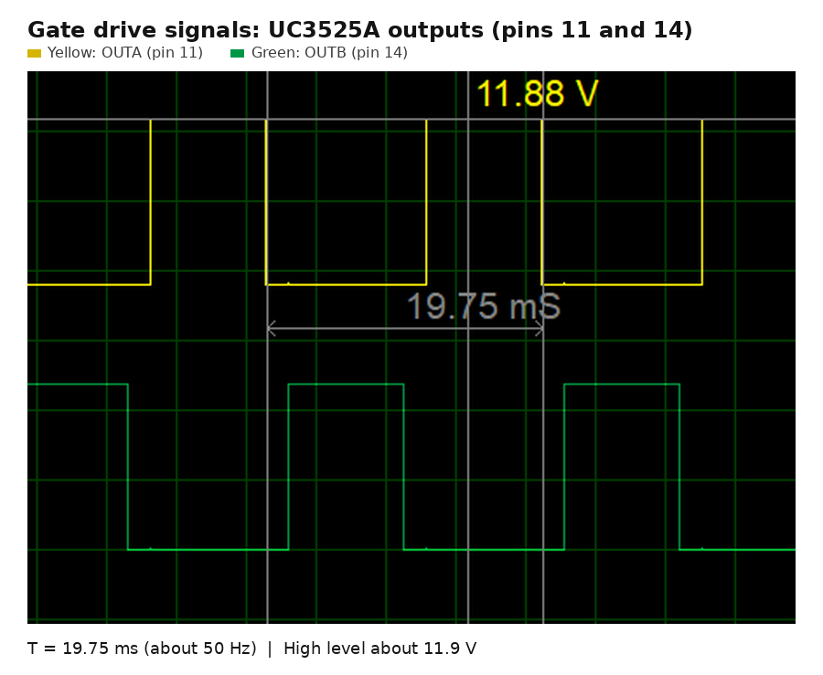
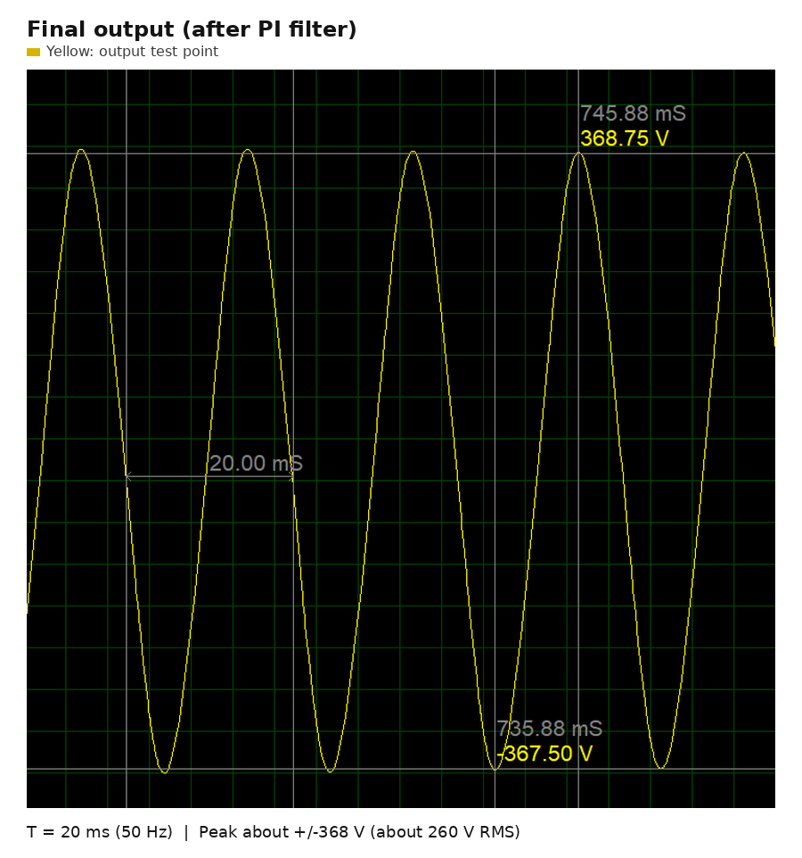

# H.E.R.O Inverter

Closed-loop 12V DC to AC inverter with feedback regulation and protection circuits, designed and simulated in Proteus.

This inverter is the power-conversion stage of **H.E.R.O (Hybrid Energy Resource Optimizer)**, my ongoing off-grid power system project. I designed it in my 2nd semester after teaching myself power electronics.

> **Status:** Inverter stage completed and verified in simulation. Hardware not built.


## Specifications

| Parameter | Value |
|---|---|
| Input | 12V DC battery |
| Output | 224-240 V AC |
| Output frequency | 50 Hz |
| PWM controller | UC3525A |
| Gate drivers | TC4420 |
| Switches | 8x IRF3205 MOSFETs (4 per side) |
| Topology | Push-pull with step-up transformer |
| Simulation tool | Proteus |

## How it works

1. **PWM controller and gate drivers:** The UC3525A generates two complementary PWM signals. Two TC4420 drivers boost them to drive the MOSFET gates quickly. RV2 sets the frequency, and the soft-start capacitor limits turn-on stress.
2. **MOSFET switching stage:** Four IRF3205 MOSFETs on each side of the transformer's center-tapped primary switch alternately, turning the 12V DC into an alternating signal.
3. **Transformer and PI filter:** TR1 steps the voltage up. RC snubbers (R30/C3 and R31/C4) reduce switching spikes. An L-C PI filter (L3, C8, C9) smooths the output.
4. **Voltage feedback:** TR2 and a bridge rectifier sample the output and feed a DC level back to the UC3525A, which adjusts the duty cycle to keep the output steady when the load or battery voltage changes. RV4 sets the feedback level.
5. **Under/over-voltage protection:** LM358 comparators (U3:A, U3:B) monitor the voltage against thresholds set by RV1 and RV3, shut down the PWM when it is out of range, and light indicator LEDs.
6. **Overcurrent / short-circuit protection:** A 0.01 ohm shunt (R32) senses current. When it exceeds the limit, a transistor stage (Q13, Q14) shuts down the PWM and lights an indicator LED.

## Simulation results

Waveforms at each stage (oscilloscope screenshots):

| Stage | Screenshot |
|---|---|
| Gate drive (PWM at MOSFET gates) |  |
| MOSFET drain |  |
| Transformer output |  |
| Final output (after PI filter) |  |

Normal vs fault behavior for the feedback and protection circuits is shown in the documentation PDFs below.

## Documentation

Each section has a PDF with the schematic, explanation and simulation screenshots:

1. [PWM Controller and Gate Drivers](Documentation/01_PWM_Controller_and_Gate_Drivers.pdf)
2. [MOSFET Switching Stage](Documentation/02_MOSFET_Switching_Stage.pdf)
3. [Transformer and PI Filter](Documentation/03_Transformer_and_PI_Filter.pdf)
4. [Voltage Feedback](Documentation/04_Voltage_Feedback.pdf)
5. [Under/Over-Voltage Protection](Documentation/05_Under_Over_Voltage_Protection.pdf)
6. [Overcurrent Protection](Documentation/06_Overcurrent_Protection.pdf)

Also: [Component List](Documentation/Component_List.pdf) | [Full circuit (PDF)](Circuit/Full_Circuit.pdf)

## Repository structure

```
Circuit/          Schematic images and block diagram
Simulation/       Proteus project files
Documentation/    Per-section explanations and test screenshots
Results/          Waveforms from each stage
```

## How to run the simulation

1. Install Proteus 8 Professional.
2. Open the project file in `Simulation/Proteus_Project/`.
3. Press Play. View the waveforms on the oscilloscope.

## Author

Mohd Rihan, BSc EMCS, National College, Basavanagudi
